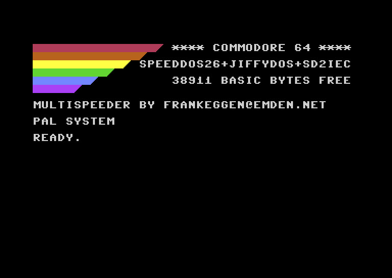
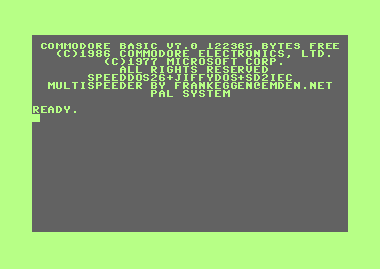
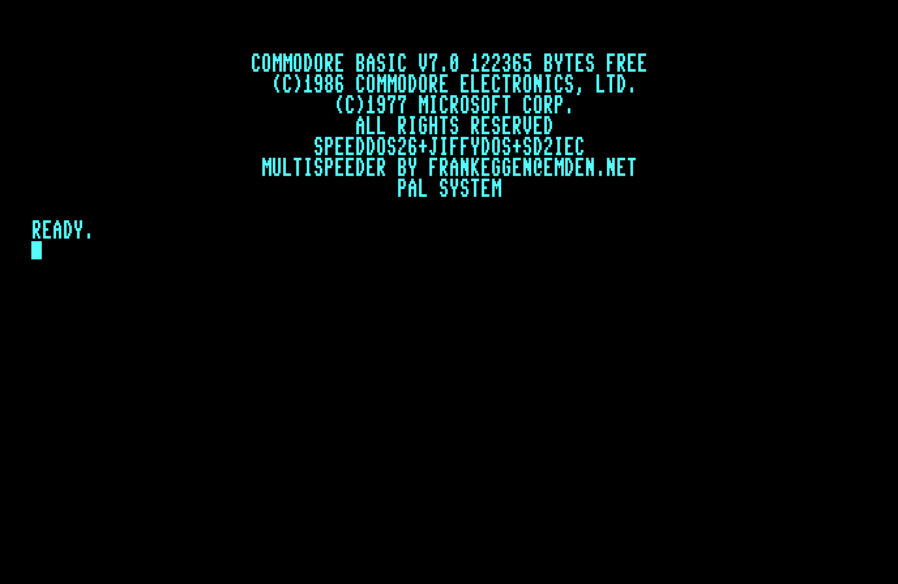

<p align="center"></p>

# SpeedDos26

**Kernal for the C64 and the C128 and drive firmware for the 1541 and the 1571 for the SpeedDOS parallel cable: Commodore 1541, 1541-II, the 1541 Switchless 8x Multi-Floppy-Speeder V3 and the 1571 (external 1571 and C128DCR) with the 1571 Switchless Multi-Speeder V3. A further development of SpeedDOS+ with JiffyDOS protocol, SD2IEC keys and 40 tracks.**

**Language:** [English](#english) · [Deutsch](#deutsch)

| | English | Deutsch |
|---|---|---|
| SpeedDos26 manual (C64 and C128 kernal, 1541 and 1571 firmware) | [PDF](manuals/en/SpeedDos26_Manual.pdf) | [PDF](manuals/de/SpeedDos26_Handbuch.pdf) |
| Technical notes | [docs/en](docs/en) | [docs/de](docs/de) |

**Hardware projects / Hardware-Projekte:**

| Project / Projekt | Repository |
|---|---|
| Multi-Speeder project (entry page) / Multi-Speeder-Projekt (Einstieg) | [github.com/FraEgg/Switchless-Multi-Speeder-Project](https://github.com/FraEgg/Switchless-Multi-Speeder-Project) |
| Parallel port adapter for 1541 and C64/C128 (SpeedDOS, DolphinDOS) / Parallelport-Adapter für 1541 und C64/C128 | [github.com/FraEgg/commodore-1541-parallel-port-adapter-c64-c128-speeddos-dolphindos](https://github.com/FraEgg/commodore-1541-parallel-port-adapter-c64-c128-speeddos-dolphindos) |
| 1541 Parallel Adapter SpeedDOS by / von Sven Petersen | [github.com/svenpetersen1965/1541-parallel-adapter-SpeedDOS](https://github.com/svenpetersen1965/1541-parallel-adapter-SpeedDOS) |
| Switchless 8x Multi-Floppy-Speeder V3 for the 1541 / für die 1541 | [github.com/FraEgg/Switchless-Multi-Speeder-Commodore-1541](https://github.com/FraEgg/Switchless-Multi-Speeder-Commodore-1541) |
| Switchless 8x Multi-Floppy-Speeder V3 for the C128DCR (1571) / für den C128DCR (1571) | [github.com/FraEgg/Switchless-Multi-Speeder-Commodore-C128DCR-1571](https://github.com/FraEgg/Switchless-Multi-Speeder-Commodore-C128DCR-1571) |
| Switchless 8x Multi-Floppy-Speeder V3 for the external 1571 / für die externe 1571 | [github.com/FraEgg/Switchless-Multi-Speeder-Commodore-1571](https://github.com/FraEgg/Switchless-Multi-Speeder-Commodore-1571) |
| DolphinDos26 (sister project / Schwesterprojekt) | [github.com/FraEgg/DolphinDOS](https://github.com/FraEgg/DolphinDOS) |

> **Status:** New in this release are the firmware for the 1571 in two builds (`C1571SpeedDOS26.bin` for the external 1571, `C1571CRSpeedDOS26.bin` for the C128DCR; the drive switches to 2 MHz by itself) and the C128 kernal (`C128SpeedDos26-DE.bin`, `C128SpeedDos26-EN.bin`). The manual covers all parts. The PIA parallel port adapter for a 1571 without Multi-Speeder is a draft (schematic rev. 0.1, not built, not measured). Reports and feedback are very welcome.

---

# English

## What is this?

SpeedDos26 (SD26) is a further development of the floppy speeder **SpeedDOS+** by Oliver Eikemeier and Oliver Joppich from 1984. The number stands for the year 2026. SpeedDos26 is a sub-project of the **Multi-Speeder V3** and of **DolphinDos26**. It is a revision of the legendary firmware SpeedDOS+, so that it works better today with current hardware such as the SD2IEC. It now also includes versions for the 1571 and the C128. Computer and drive are connected by an 8-bit parallel cable at the user port in addition to the serial cable. In use it stays close to the original: parallel loading and saving, the fast loader, the DOS commands with the at sign, 40 tracks and the shortcuts for LOAD and SAVE work as before.

The project consists of four parts:

| Part | What it does | Runs on |
|---|---|---|
| **C64SpeedDos26** | C64 kernal that combines SpeedDOS parallel, JiffyDOS and standard serial, with function keys for SD2IEC | C64, C64 II, and C128 in C64 mode |
| **C1541SpeedDOS26** | Drive firmware for the 1541 in two builds: 8 KB (upper ROM only) and 16 KB | 1541 with two ROMs, 1541-II, 1541 with Switchless Multi-Speeder V3 (bank 3) |
| **C1571SpeedDOS26**, **C1571CRSpeedDOS26** (new) | Drive firmware for the 1571 in two builds (external 1571, 1571 in the C128DCR) with the parallel cable on a PIA 6821 (on the Multi-Speeder board), automatic 2 MHz mode, double-sided disks and a built-in fast loader | External 1571 and 1571 in the C128DCR with 1571 Switchless Multi-Speeder V3; draft: without Multi-Speeder with the PIA parallel port adapter |
| **C128SpeedDos26** (new) | C128 kernal with burst, SpeedDOS parallel, JiffyDOS and serial, loading into any memory bank and the function keys of the C64 kernal; German (DIN) and US keyboard | C128 in C128 mode |

On the wire the 1571 behaves like a 1541 with SpeedDos26: every SpeedDos26 kernal works with both drives, and the C128 kernal also works with a 1541.

<p align="center"></p>

## Files

| File | Size | Purpose |
|---|---|---|
| [`C64SpeedDos26.bin`](rom/C64SpeedDos26.bin) | 8 KB | C64 kernal (`$E000`–`$FFFF`): SpeedDOS parallel, JiffyDOS and serial in one kernal |
| [`C64IISpeedDos26.bin`](rom/C64IISpeedDos26.bin) | 16 KB | BASIC and kernal for the C64 II (ROM 251913) and for the C64 mode of the C128 |
| [`C1541SpeedDOS26.bin`](rom/C1541SpeedDOS26.bin) | 8 KB | Upper ROM of the 1541 (`$E000`–`$FFFF`); the lower Commodore ROM 325302-01 stays in the drive |
| [`C1541IISpeedDOS26.bin`](rom/C1541IISpeedDOS26.bin) | 16 KB | ROM of the 1541-II (`$C000`–`$FFFF`); also the content of bank 3 of the 1541 Multi-Speeder V3 |
| [`C1571SpeedDOS26.bin`](rom/C1571SpeedDOS26.bin) | 32 KB | DOS ROM (`$8000`–`$FFFF`) for the external 1571 (replaces 310654-05) |
| [`C1571CRSpeedDOS26.bin`](rom/C1571CRSpeedDOS26.bin) | 32 KB | DOS ROM (`$8000`–`$FFFF`) for the 1571 in the C128DCR (replaces 318047-01) |
| [`C128SpeedDos26-DE.bin`](rom/C128SpeedDos26-DE.bin) | 16 KB | Kernal of the C128 (`$C000`–`$FFFF`) with German keyboard (DIN) |
| [`C128SpeedDos26-EN.bin`](rom/C128SpeedDos26-EN.bin) | 16 KB | Kernal of the C128 (`$C000`–`$FFFF`) with US keyboard |
| [`C1541_29F040.BIN`](rom/C1541_29F040.BIN) | 512 KB | Complete EPROM image for the 1541 Switchless Multi-Speeder V3 with SpeedDos26 in bank 3 |

The checksums of all files are in [`CHECKSUMS.md5`](CHECKSUMS.md5) and [`CHECKSUMS.sha256`](CHECKSUMS.sha256); the manual also states the MD5 of every ROM file.

## Which files do I need?

| Your hardware | Drive ROM | Kernal | Documentation |
|---|---|---|---|
| **1541 with two 8 KB ROMs** and SpeedDOS parallel cable | [`C1541SpeedDOS26.bin`](rom/C1541SpeedDOS26.bin): replace only the upper ROM UB4 (901229, `$E000`–`$FFFF`); UB3 (325302-01) stays | [`C64SpeedDos26.bin`](rom/C64SpeedDos26.bin) | [Manual](manuals/en/SpeedDos26_Manual.pdf) |
| **1541-II** (one 16 KB ROM) and SpeedDOS parallel cable | [`C1541IISpeedDOS26.bin`](rom/C1541IISpeedDOS26.bin): replace ROM U4 (251968) | [`C64SpeedDos26.bin`](rom/C64SpeedDos26.bin) | [Manual](manuals/en/SpeedDos26_Manual.pdf) |
| **1541 with Switchless Multi-Speeder V3** and SpeedDOS parallel cable on the VIA | [`C1541_29F040.BIN`](rom/C1541_29F040.BIN): flash EPROM of the Multi-Speeder; SpeedDos26 is in bank 3 | [`C64SpeedDos26.bin`](rom/C64SpeedDos26.bin) | [Manual](manuals/en/SpeedDos26_Manual.pdf), chapter 2; hardware: [repository](https://github.com/FraEgg/Switchless-Multi-Speeder-Commodore-1541) |
| **External 1571 or C128DCR with 1571 Switchless Multi-Speeder V3** (6821 PIA and connector CN1 on the board) | External 1571: [`C1571SpeedDOS26.bin`](rom/C1571SpeedDOS26.bin); C128DCR: [`C1571CRSpeedDOS26.bin`](rom/C1571CRSpeedDOS26.bin); into the upper half of a bank of the flash EPROM (`$x8000`–`$xFFFF`); banks 5 and 6 in the ready-made images | C64: [`C64SpeedDos26.bin`](rom/C64SpeedDos26.bin) or [`C64IISpeedDos26.bin`](rom/C64IISpeedDos26.bin); C128: [`C128SpeedDos26-DE.bin`](rom/C128SpeedDos26-DE.bin) or [`C128SpeedDos26-EN.bin`](rom/C128SpeedDos26-EN.bin) plus `C64IISpeedDos26.bin` for C64 mode | [Manual](manuals/en/SpeedDos26_Manual.pdf), chapter “SpeedDos26 for the 1571 and the C128”; [1571 notes](docs/en/c1571-firmware.md); hardware: [external 1571](https://github.com/FraEgg/Switchless-Multi-Speeder-Commodore-1571), [C128DCR](https://github.com/FraEgg/Switchless-Multi-Speeder-Commodore-C128DCR-1571) |
| **1571 without Multi-Speeder, with the PIA parallel port** (adapter in the CPU socket; **draft**, see below) | [`C1571SpeedDOS26.bin`](rom/C1571SpeedDOS26.bin) (external 1571) or [`C1571CRSpeedDOS26.bin`](rom/C1571CRSpeedDOS26.bin) (C128DCR) as a 27C256 EPROM in the ROM socket of the drive | as above | [Manual](manuals/en/SpeedDos26_Manual.pdf), same chapter, with the schematic |

**C64 II (short board) and C128 in C64 mode:** BASIC and kernal share one ROM chip (251913). Use [`C64IISpeedDos26.bin`](rom/C64IISpeedDos26.bin) (16 KB, BASIC and kernal in one file) there instead of `C64SpeedDos26.bin`.

**The two 1571 ROMs are not interchangeable:** the external 1571 and the 1571 in the C128DCR have different hardware and therefore each need their own version; both behave the same.

**C128:** For C128 mode, [`C128SpeedDos26-DE.bin`](rom/C128SpeedDos26-DE.bin) (German keyboard, DIN) or [`C128SpeedDos26-EN.bin`](rom/C128SpeedDos26-EN.bin) (US keyboard) replaces the kernal ROM of the C128 (318020-05, 16 KB). In the kernal switcher of the C128DCR the file belongs at `$xC000` of the bank, `C64IISpeedDos26.bin` at `$x8000`.

The kernal also works without the parallel cable and with any drive: on every access it detects by itself whether the addressed device supports the parallel cable, JiffyDOS or only the serial bus.

## Hardware requirements

- **The SpeedDOS parallel cable.** On the 1541 it connects the user port of the C64 to the VIA 6522 of the drive that also serves the serial bus (position UC3 in the 1541); the adapter sits between socket and chip. The serial cable remains connected as well. DolphinDOS 2 and DolphinDos26UL use the same cable.

  | 1541 (VIA 1, `$1800`) | C64 (CIA 2, user port) | Meaning |
  |---|---|---|
  | Port A, PA0–PA7 (`$1801`) | PB0–PB7 (`$DD01`), user port C–L | 8 data lines |
  | CB1 | PC2, user port 8 | pulse on every access of the C64 to `$DD01` |
  | CA2 | FLAG2, user port B | pulse on every access of the 1541 to `$1801` |

  For building it I recommend these two projects: the [parallel port adapter for 1541 and C64/C128](https://github.com/FraEgg/commodore-1541-parallel-port-adapter-c64-c128-speeddos-dolphindos) and the [1541 Parallel Adapter SpeedDOS by Sven Petersen](https://github.com/svenpetersen1965/1541-parallel-adapter-SpeedDOS).
- **1541 Switchless Multi-Speeder V3:** banks 1 to 4 of the Multi-Speeder work without its PIA chip; in bank 3 SpeedDos26 uses the parallel cable on the VIA, as in a 1541 without Multi-Speeder. Hardware: [Switchless-Multi-Speeder-Commodore-1541](https://github.com/FraEgg/Switchless-Multi-Speeder-Commodore-1541).
- **1571:** In the 1571, port A of the VIA chip is in use (head, disk side, clock). The parallel cable is therefore connected to an additional **PIA 6821 at `$5000`**. The signals at the user port are the same as with the SpeedDOS cable of the 1541:

  | 1571 (PIA 6821, `$5000`) | C64/C128 (CIA 2, user port) | Meaning |
  |---|---|---|
  | Port A, PA0–PA7 (`$5000`) | PB0–PB7 (`$DD01`), user port C–L | 8 data lines |
  | CA1 | PC2, user port 8 | pulse on every access of the computer to `$DD01` |
  | CA2 | FLAG2, user port B | pulse of the drive as acknowledgement |

  There are two ways to get the PIA:
  - **1571 Switchless Multi-Speeder V3** (external 1571 or C128DCR): PIA and connector CN1 are on the board. Hardware: [external 1571](https://github.com/FraEgg/Switchless-Multi-Speeder-Commodore-1571), [C128DCR](https://github.com/FraEgg/Switchless-Multi-Speeder-Commodore-C128DCR-1571).
  - **PIA parallel port without Multi-Speeder:** a small board between the 6502 processor and its socket. It carries the PIA 6821 (or W65C21N), a 74HCT138 and a 74HCT08. The 74HCT138 derives the select of the PIA for `$5000`–`$5FFF` from A12 to A15. Of all processor lines only R/W (pin 34) is cut: the gate of the 74HCT08 presents a write access to the main board on every access to the PIA, so that no chip there drives the data bus. The connector CN1 (2×5) has the pinout of CN1 of the 1571 Multi-Speeder: pin 1 CA2, pins 2 to 9 PA0 to PA7, pin 10 CA1. Ground comes via the serial cable. The schematic is in the manual.

  > **Draft:** The schematic of the PIA parallel port is at rev. 0.1. The circuit has not yet been built or measured; the timing at 2 MHz (1571 mode) has not been calculated. On the external 1571, registers 0 to 3 of the CIA chip are written as well on every access to the PIA. SpeedDos26 addresses the PIA only via `$5000` and `$5001`.
- **EPROMs:** The 8 KB ROMs of the 1541 and the C64 (type 2364, 24 pins) have a different pinout from a 2764 EPROM, so a 2764 or 27C64 needs an adapter socket. The 16 KB ROMs of the 1541-II and the C64 II correspond to a 27128. For the Multi-Speeder I recommend a **29F040** (alternatively 27C040 or SST39SF040). The 1571 ROM for the PIA parallel port is a 27C256.

## Features

### C64SpeedDos26 kernal

- Three protocols in one kernal. The order for every access is always SpeedDOS parallel, then JiffyDOS, otherwise serial. A SpeedDos26 drive, an SD2IEC and an unmodified drive can work side by side on one bus.
- Shows the transfer method when loading: `LOADING SD:` (parallel cable) or `LOADING JD:` (JiffyDOS drive, SD2IEC), followed by start and end address.
- The coloured power-on screen and the function key assignment of DolphinDos26, with four additional keys for SD2IEC and printer.
- LOAD and SAVE without a device address, DOS commands with `@` or `>`, `@$` shows the directory without changing the program in memory.
- `@8` to `@11` (two digits up to `@19`) select the device; if it does not answer, `?DEVICE NOT PRESENT ERROR` appears.
- BASIC extras of SpeedDOS+: `!` (OLD), numbers with `$` (hexadecimal), `%` (binary) and `&` (octal), LIST with visible control characters.
- Also tested with S-JiffyDOS 1541 (SJD41), an extension of the JiffyDOS ROM for the 1541 by Jochen Adler that the kernal addresses like a JiffyDOS drive (display `LOADING JD:`). Further information: [S-JIFFYDOS 1541 (funet.fi / zimmers.net)](https://bio.nic.funet.fi/pub/cbm/c64/diskutil/misc/s-jiffydos1541.html), [Commodore News: SJD41 (2013)](https://www.commodore-news.com/news/item/2755/en/mobile), [RetroTechCollection: JiffyDOS Kernal Upgrade](https://wiki.retrotechcollection.com/JiffyDOS_Kernal_Upgrade).
- Removed compared with SpeedDOS+: the mini monitor, the Centronics interface and the screen hardcopy; the space is needed for the JiffyDOS protocol.

### SpeedDos26 for the 1541 (two builds)

- **8 KB build** for the 1541 with two ROM chips: it deliberately changes only `$E000`–`$FFFF`, so a single ROM is replaced. The price is the command `&` (utility loader), which is omitted in this build. The **16 KB build** for the 1541-II still contains `&`.
- **35 or 40 tracks:** `@N:NAME,ID` formats 35 tracks, `@N:NAME,ID+` formats 40 tracks (749 blocks free instead of 664). `@N:NAME` without ID and validate keep the number of tracks of the disk.
- File protection with `@T:NAME`; protected files show a `<` after the file type.
- The ROM check at power-on is active again; `DISK FULL` no longer comes while there is still room on the innermost tracks.
- On every reset the drive sets a PIA 6821 at `$5000` (DolphinDOS board, Multi-Speeder) to input, so that it does not disturb the transfer when its port is wired in parallel with the cable on the VIA.
- Power-on message: `73,SPEEDDOS26   1541`.

### SpeedDos26 for the 1571 (new)

- **Two builds**, based on the Commodore DOS of the 1571: `C1571SpeedDOS26.bin` for the external 1571 (basis 310654-05) and `C1571CRSpeedDOS26.bin` for the 1571 in the C128DCR (basis 318047-01). Both behave the same; they contain no DolphinDOS and no JiffyDOS code. Each file is a 32 KB ROM (`$8000`–`$FFFF`); the SpeedDos26 extension is the same for both and lies inside the ROM, in the free area of the Commodore ROM (from `$ABB0` in the external build, from `$ADD8` in the C128DCR build), covered by the ROM checksum. After power-on the drive reports `73,SPEEDDOS26   1571,00,00`.
- **Parallel cable on a PIA 6821 at `$5000`** (see hardware requirements).
- **Double-sided disks:** In 1571 mode the drive uses both sides (1328 blocks) and runs at 2 MHz; see “The 2 MHz mode”.
- **Fast loader:** It is built into the ROM. The kernal starts it exactly like that of the 1541; the display is `LOADING SD:`. It works in both modes and on both disk sides.
- **Byte-wise parallel:** `LOAD"NAME",8,2`, SAVE, VERIFY, the directory and all files go over the parallel cable.
- **File protection:** `@T:NAME` as on the 1541.
- Technical details: [docs/en/c1571-firmware.md](docs/en/c1571-firmware.md).

#### The 2 MHz mode

The 1571 has two modes: 1541 mode with 1 MHz and single-sided disks (the state after power-on) and 1571 mode with 2 MHz and double-sided disks. SpeedDos26 works in both; at 2 MHz the drive is considerably faster.

- **Automatic:** When the drive detects a SpeedDos26 kernal on the parallel cable, it switches to 1571 mode by itself on the first access – on the C128, on the C64 and in the C64 mode of the C128.
- **By hand:** `@U0>M0` switches back to 1541 mode and locks the automatic switching until `@U0>M1` or a reset releases it again. `@U0>M1` switches to 1571 mode.
- **Formatting:** In 1571 mode `@N:NAME,ID` creates a double-sided disk (1328 blocks free). For a single-sided disk (664 blocks) send `@U0>M0` first.
- **Programs with their own drive code:** Copy programs and fast loaders that load their own code into the drive usually expect the timing of the 1541. Send `@U0>M0` first. MS-15SECCOPY (from Build 19) sets the drive to 1 MHz itself for BACKUP and VERIFY and back again afterwards.
- **Single-sided disks** are read and written in 1571 mode as before.
- **Without a SpeedDos26 kernal** the drive behaves like a 1571 with Commodore DOS: a C128 switches it to 1571 mode by itself, on the C64 it stays at 1 MHz.

> **Note:** On a disk that was written in 1571 mode, the blocks of a file lie closer together. At 1 MHz the drive then misses the next block each time and needs another revolution; in this case the fast loader is no faster than byte-wise loading (see “Speed on the 1571”).

### C128SpeedDos26 kernal (new)

The kernal corresponds to the C128 kernal DolphinDos26, with SpeedDOS instead of DolphinDOS on the parallel cable:

- **Four ways:** burst, SpeedDOS parallel, JiffyDOS, serial. The kernal decides anew every time a device is addressed.
- **Burst takes precedence when loading:** If the drive supports the fast serial bus (1571 in 1571 mode), the C128 loads in burst mode like the original; that is the fastest way there. Display: `LOADING BU:`. With `LOAD"NAME",8,2` or `,8,3` burst is skipped and the file is loaded byte by byte over the parallel cable.
- **Display:** When loading with the SpeedDOS fast loader, the transfer method, bank and addresses appear, e.g. `LOADING SD: $01C01-$06A2A`; with JiffyDOS `JD:`.
- **All memory banks:** Burst and the fast loader load into any bank, so also with `BLOAD` and `BOOT`.
- **FAST mode:** The transfer also works at 2 MHz; the kernal itself briefly switches to 1 MHz for it.
- **Function keys:** as on the C64, F8 shows the message of the drive. F1 to F8 can still be changed with `KEY`.
- **Power-on screen:** `SPEEDDOS26+JIFFYDOS+SD2IEC`, below it the note on the Multi-Speeder and `PAL SYSTEM` or `NTSC SYSTEM`.
- There is no cassette and no RS-232.
- Technical details: [docs/en/c128-kernal.md](docs/en/c128-kernal.md).

<p align="center">


</p>

<p align="center"><em>Boot screen of the C128 kernal SpeedDos26 in 40-column mode and in 80-column mode (VDC).</em></p>

## Quick start

After power-on the C64 shows the coloured power-on screen. **F8** shows the message of the drive, after power-on `73,SPEEDDOS26   1541,00,00`; **F7** shows the directory.

```
@N:NAME,ID        format a disk with 35 tracks
@N:NAME,ID+       format a disk with 40 tracks
LOAD"NAME"        load from the drive selected last (device 8 after power-on)
SAVE"NAME"        save
@                 message of the drive
@$                directory
@I:3@RNROM        1541 Multi-Speeder: switch to SpeedDos26 (bank 3)
@I:5@RNROM        1571 Multi-Speeder: switch to SpeedDos26 (bank 5 or 6)
```

When loading, the transfer method appears after `LOADING`: `LOADING SD:` means the parallel cable is working, `LOADING JD:` appears with a JiffyDOS drive or SD2IEC, and only `LOADING` with a drive without a speeder. If a program does not load, try `LOAD"NAME",8,2` (byte by byte without the fast loader).

| Key | Text | Effect |
|---|---|---|
| F1 | `LIST` | clear the screen and list the program |
| F2 | `RUN:` | start the program |
| F3 | `RUN` | clear the screen and start the program |
| F4 | `VERIFY` | compare the program in memory with the first program on the disk |
| F5 | `LOAD` | load the first program on the disk; on a directory line: load that program |
| F6 | `SAVE"@:` | without RETURN: add the name |
| F7 | `@$` | clear the screen and show the directory |
| F8 | `@` | show the message of the drive |
| C= + F1 | `OPEN4,4:CMD4:LIST` | without RETURN: output the program on the printer |
| C= + F3 | `@CD←` | SD2IEC: one directory or disk image back |
| C= + F5 | `@"CD:` | SD2IEC, on a directory line: change into that directory or disk image |
| C= + F7 | `LOAD` | on a directory line: write `LOAD` in front of the name (press RETURN yourself) |

The DOS commands, the function keys and the extended LIST function can be switched off with `SYS 58451` and switched on again with `SYS 62545`.

## Performance

Guide values from the manual for a program of 30 KB (119 blocks):

| Drive | LOAD | LOAD `,8,2` | SAVE |
|---|---|---|---|
| 1541 with SpeedDos26, parallel cable | 13 s, saved with SpeedDos26 8 s | 25 s | 61 s |
| 1541 with JiffyDOS | 12 s | 33 s | 34 s |
| 1541 with Commodore DOS, serial | 74 s | 74 s | 93 s |

### Speed on the 1571

Measured with a C128 and a 1571 (C128DCR) using a BASIC program of 30 KB (118 blocks) on a double-sided disk, from sending the command until the computer is ready again. “Computer 2 MHz” is the FAST mode of the C128, “drive 1 MHz” is 1541 mode after `@U0>M0`.

**C128 mode with SpeedDos26** (kernal `C128SpeedDos26`, drive `C1571CRSpeedDOS26`; with the drive at 2 MHz LOAD runs in burst mode, at 1 MHz with the fast loader over the parallel cable):

| Computer | Drive | LOAD | LOAD `,8,2` | SAVE |
|---|---|---|---|---|
| 1 MHz | 2 MHz | 9 s | 27 s | 55 s |
| 2 MHz (FAST) | 2 MHz | 8 s | 20 s | 54 s |
| 1 MHz | 1 MHz | 32 s | 32 s | 58 s |
| 2 MHz (FAST) | 1 MHz | 31 s | 31 s | 41 s |

**C64 mode with SpeedDos26** (kernal `C64SpeedDos26`, drive `C1571CRSpeedDOS26`):

| Computer | Drive | LOAD | LOAD `,8,2` | SAVE |
|---|---|---|---|---|
| 1 MHz | 2 MHz | 9 s | 20 s | 54 s |
| 1 MHz | 1 MHz | 31 s | 31 s | 57 s |

**For comparison: Commodore kernal and Commodore DOS of the 1571** (burst in C128 mode, serial in C64 mode):

| Mode | Computer | Drive | LOAD | SAVE |
|---|---|---|---|---|
| C128 mode | 1 MHz | 2 MHz | 9 s | 57 s |
| C128 mode | 2 MHz (FAST) | 2 MHz | 8 s | 56 s |
| C128 mode | 1 MHz | 1 MHz | 80 s | 82 s |
| C128 mode | 2 MHz (FAST) | 1 MHz | 76 s | 55 s |
| C64 mode | 1 MHz | 2 MHz | 76 s | 72 s |
| C64 mode | 1 MHz | 1 MHz | 78 s | 79 s |

- **C64 mode:** This is where SpeedDos26 gains most – 9 s instead of 76 s when loading.
- **C128 mode:** SpeedDos26 loads in burst mode as fast as the Commodore original (9 s). The fast loader over the parallel cable would need 13 s on the 1571; that is why burst takes precedence there.
- **Drive at 1 MHz:** With this disk the fast loader falls back to the time of byte-wise loading (note in the section “The 2 MHz mode”). With a disk written in 1541 mode it loads 30 KB in about 14 s.
- **Saving** with SpeedDos26 on the 1571 is not faster than with Commodore DOS in 1571 mode.

## Installation in short

**C64:** Program `C64SpeedDos26.bin` and fit it in place of the kernal ROM (901227, socket U4), or put it into a kernal switcher. **C64 II / C128 (C64 mode):** program `C64IISpeedDos26.bin` (16 KB) and fit it in place of the combined BASIC/kernal ROM 251913.

**1541 with two ROMs:** Replace only the upper ROM UB4 with `C1541SpeedDOS26.bin`. The lower ROM must be the Commodore ROM 325302-01. **1541-II:** replace ROM U4 with `C1541IISpeedDOS26.bin`. Then connect the parallel cable: adapter at the VIA of the 1541, plug at the user port of the C64.

**1541 Switchless Multi-Speeder V3:** Program `C1541_29F040.BIN` into a 29F040 (alternatively 27C040 or SST39SF040) and fit it. Switch with `@I:3@RNROM`. Bank layout of the image:

| Bank | Contents | Command |
|---|---|---|
| 1, 4, 5, 6 | CBM DOS 2.6 | `1@RNROM` etc. |
| 2 | DolphinDOS 2.0 | `2@RNROM` |
| 3 | **SpeedDos26** | `3@RNROM` |
| 7 | DolphinDos26DD2 | `7@RNROM` |
| 8 | DolphinDos26 | `8@RNROM` |

**C128:** Program `C128SpeedDos26-DE.bin` (German keyboard, DIN) or `C128SpeedDos26-EN.bin` (US keyboard) and fit it in place of the kernal ROM 318020-05 (16 KB). In the kernal switcher of the C128DCR the file belongs at `$xC000` of the bank, `C64IISpeedDos26.bin` at `$x8000`.

**1571 Switchless Multi-Speeder V3:** In the EPROM images for the 1571 Multi-Speeder V3, SpeedDos26 is in **bank 5 and bank 6**; switch with `@I:5@RNROM` or `@I:6@RNROM`. The drive ROM – `C1571SpeedDOS26.bin` (external 1571) or `C1571CRSpeedDOS26.bin` (C128DCR), 32 KB each – lies in the upper half of the bank (`$x8000`–`$xFFFF`). Program a 29F040 (alternatively 27C040 or SST39SF040).

| Bank | Drive | Kernal in the C128DCR | Command |
|---|---|---|---|
| 1, 2, 7, 8 | Commodore DOS | Commodore | `1@RNROM` etc. |
| 3 | DolphinDOS 3 | DolphinDOS | `3@RNROM` |
| 4 | DolphinDos26 | DolphinDos26 | `4@RNROM` |
| 5 | **SpeedDos26** | C128SpeedDos26 with US keyboard, C64SpeedDos26 | `5@RNROM` |
| 6 | **SpeedDos26** | C128SpeedDos26 with German keyboard, C64SpeedDos26 | `6@RNROM` |

In the C128DCR, drive and kernal switch together. On the external 1571, bank 5 and bank 6 select the same drive ROM; the computer has its own kernal ROM there. The ready-made 512 KB images named in the manual (`C1571_29F040.BIN`, `C1571_C128DCR_29F040.BIN`, `C128DCR_KERNAL_29F040-DE.BIN`, `C128DCR_KERNAL_29F040-US.BIN`) also contain other firmware and are not part of this repository; they are provided with the hardware projects.

**1571 with the PIA parallel port (draft):** Program `C1571SpeedDOS26.bin` (external 1571) or `C1571CRSpeedDOS26.bin` (C128DCR) into a 27C256 EPROM and fit it in the ROM socket of the drive; the adapter sits in the CPU socket. Note the draft status of the adapter under “Hardware requirements”.

Full steps for C64 and 1541, including personalising the colours, are in the manual.

## Known limits

- There is no cassette and no RS-232 in the kernal; the space is needed for the extensions. If you need them, switch to the original kernal.
- The user port belongs to the parallel cable. Other devices at the user port and the parallel cable are mutually exclusive.
- Programs with their own fast loader or copy protection sometimes only run with the original kernal and the original DOS. Try `LOAD"NAME",8,2` and `SYS 58451` first.
- The 8 KB build of the 1541 firmware requires the Commodore ROM 325302-01 as the lower ROM; with a different lower ROM the ROM check reports an error (the LED flashes permanently). It has no command `&`.
- The fast loader requires SpeedDos26 or SpeedDOS+ in the drive. With a different drive ROM at the parallel cable the kernal loads byte by byte.
- Every further drive that is to work in parallel needs its own ROM and its own connection to the parallel cable.
- A drive with Commodore DOS reads only tracks 1 to 35 of a 40-track disk and should not write to such disks. Not every disk and not every drive reaches tracks 36 to 40 reliably.
- **1571 firmware:** no 40 tracks (in the double-sided format track 36 is already the reverse side; a `+` after the ID has no effect), no fast formatting and no SpeedDOS sector order when saving. The two builds are not interchangeable (external 1571 / C128DCR). In C128 mode the kernal loads from the 1571 in burst mode (`LOADING BU:`), because the parallel fast loader would be slower there; saving is not faster than with Commodore DOS in 1571 mode (see “Speed on the 1571”).
- **PIA parallel port for the 1571:** a draft (schematic rev. 0.1), not yet built or measured; the timing at 2 MHz has not been calculated.
- **C128 kernal:** no cassette and no RS-232.

## What is in this repository?

```
rom/             C64 and C128 kernal, drive ROMs, EPROM image for the 1541 Multi-Speeder
manuals/en, de   Manual as PDF
docs/en, de      Technical notes (C64 and C128 kernal, 1541 and 1571 firmware)
assets/          Images for this page
tools/           Maintenance script for this repository
CHECKSUMS.*      MD5 and SHA-256 of all published files
```

The source code is **not** part of this repository. The manual and the technical notes mention folders such as `Builds`, `SpeedDos26`, `SpeedDOS+` and `C128DD26`; these are the development folders. See [docs/README.md](docs/README.md).

The EPROM image `C1541_29F040.BIN` contains no JiffyDOS drive firmware. Apart from bank 3 it is identical to the template in the [hardware repository of the 1541 Multi-Speeder](https://github.com/FraEgg/Switchless-Multi-Speeder-Commodore-1541).

Verify your download with `sha256sum -c CHECKSUMS.sha256` or `md5sum -c CHECKSUMS.md5`.

## JiffyDOS licence: please check

The C64 and the C128 kernal contain JiffyDOS transfer routines that are instruction-identical to a JiffyDOS kernal (C64: JiffyDOS sd2iec kernal, C128: JiffyDOS C128 kernal; taken over from the C64 and the C128 kernal DolphinDos26). The JiffyDOS drive firmware is not included. Jim Brain of RETRO Innovations, which holds the JiffyDOS licence rights, confirmed that publishing the kernals on GitHub is fine. As he describes it, code that implements the same transfer behaviour without being an exact copy needs no licence. If the transfer code is the same, as it is here, he believes the end user would need one.

**Please check for yourself whether your use calls for an official JiffyDOS licence:** <https://www.jiffydos.com>

Details: [docs/en/speeddos26-notes.md](docs/en/speeddos26-notes.md#jiffydos-jiffydos), [docs/en/c128-kernal.md](docs/en/c128-kernal.md).

## Origin and credits

**My thanks go to Oliver Eikemeier and Oliver Joppich** for SpeedDOS, which spared many C64 owners the wait for the 1541 in the 1980s.

**Special thanks to Jim Brain of RETRO Innovations** for his support with the JiffyDOS implementation, which has been taken over from the C64 and the C128 kernal DolphinDos26.

| Who | What |
|---|---|
| Oliver Eikemeier and Oliver Joppich, 1984; manufactured and sold by Elektronik Service – Christoph Dichte | SpeedDOS and SpeedDOS+, the basis of the C64 kernal and the 1541 firmware |
| Frank Eggen | SpeedDos26 extensions and the manual; power-on screen, function keys and display of the transfer method from DolphinDos26; C128 kernal DolphinDos26, the basis of the C128 kernal |
| Günther Jilg, Jan Bubela (Dolphin Software) | DolphinDOS, the base of DolphinDos26 |
| Mark Fellows / Creative Micro Designs; today licensed through Jim Brain, RETRO Innovations | JiffyDOS |
| Commodore | CBM DOS 1541 and 1571, C64 kernal and BASIC, C128 kernal and screen editor |
| Peter Karlsson (project iDOC=), Peter Hagemann (text version, 2001) | Electronic version of the SpeedDOS Plus instructions |
| Sven Petersen | 1541 Parallel Adapter SpeedDOS |

## Licence, disclaimer, contact

Terms of use: [LICENSE.md](LICENSE.md). JiffyDOS is licensed today via Jim Brain, RETRO Innovations. In short: private, non-commercial use, no sale without asking the developer. This is a private hobby project, provided without any warranty and used at your own risk. Formatting and writing change disks irreversibly, so make backups first. Observe copyright when copying disks.

- Developer: Frank Eggen, <frankeggen@emden.net>
- Projects: <https://github.com/FraEgg/Switchless-Multi-Speeder-Project>
- Voluntary donation: [PayPal](https://www.paypal.com/donate/?cmd=_s-xclick&hosted_button_id=Q8HXKYARXKT4L&ssrt=1714757590172)

---

# Deutsch

## Worum geht es?

SpeedDos26 (SD26) ist eine Weiterentwicklung des Floppy-Beschleunigers **SpeedDOS+** von Oliver Eikemeier und Oliver Joppich aus dem Jahr 1984. Die Zahl steht für das Jahr 2026. SpeedDos26 ist ein Unterprojekt des **Multi-Speeder V3** und von **DolphinDos26**. Es ist eine Überarbeitung der legendären Firmware SpeedDOS+, damit sie heute besser mit aktueller Hardware wie dem SD2IEC zusammenarbeitet. Dazu gehören inzwischen auch Fassungen für die 1571 und den C128. Rechner und Laufwerk sind zusätzlich zum seriellen Kabel über ein 8-Bit-Parallelkabel am Userport verbunden. In der Bedienung bleibt es nah am Original: paralleles Laden und Speichern, der Schnelllader, die DOS-Befehle mit dem Klammeraffen, 40 Spuren und die Erleichterungen für LOAD und SAVE funktionieren wie gewohnt.

Das Projekt besteht aus vier Teilen:

| Teil | Aufgabe | Läuft auf |
|---|---|---|
| **C64SpeedDos26** | C64-Kernal, der SpeedDOS parallel, JiffyDOS und seriell vereint, mit Funktionstasten für SD2IEC | C64, C64 II und C128 im C64-Modus |
| **C1541SpeedDOS26** | Laufwerks-Firmware für die 1541 in zwei Fassungen: 8 KB (nur oberes ROM) und 16 KB | 1541 mit zwei ROMs, 1541-II, 1541 mit Switchless Multi-Speeder V3 (Bank 3) |
| **C1571SpeedDOS26**, **C1571CRSpeedDOS26** (neu) | Laufwerks-Firmware für die 1571 in zwei Fassungen (externe 1571, 1571 im C128DCR) mit dem Parallelkabel an einem PIA 6821 (auf der Multi-Speeder-Platine), automatischem 2-MHz-Betrieb, doppelseitigen Disketten und eingebautem Schnelllader | Externe 1571 und 1571 im C128DCR mit 1571 Switchless Multi-Speeder V3; Entwurf: ohne Multi-Speeder mit dem Adapter „PIA-Parallelport“ |
| **C128SpeedDos26** (neu) | C128-Kernal mit Burst, SpeedDOS parallel, JiffyDOS und seriell, Laden in jede Speicherbank und den Funktionstasten des C64-Kernals; deutsche (DIN) und US-Tastatur | C128 im C128-Modus |

Auf der Leitung verhält sich die 1571 wie eine 1541 mit SpeedDos26: Jeder SpeedDos26-Kernal arbeitet mit beiden Laufwerken, und der C128-Kernal arbeitet auch mit einer 1541.

## Dateien

| Datei | Größe | Zweck |
|---|---|---|
| [`C64SpeedDos26.bin`](rom/C64SpeedDos26.bin) | 8 KB | C64-Kernal (`$E000`–`$FFFF`): SpeedDOS parallel, JiffyDOS und seriell in einem Kernal |
| [`C64IISpeedDos26.bin`](rom/C64IISpeedDos26.bin) | 16 KB | BASIC und Kernal für den C64 II (ROM 251913) und für den C64-Modus des C128 |
| [`C1541SpeedDOS26.bin`](rom/C1541SpeedDOS26.bin) | 8 KB | Oberes ROM der 1541 (`$E000`–`$FFFF`); das untere Commodore-ROM 325302-01 bleibt im Laufwerk |
| [`C1541IISpeedDOS26.bin`](rom/C1541IISpeedDOS26.bin) | 16 KB | ROM der 1541-II (`$C000`–`$FFFF`); auch der Inhalt von Bank 3 des 1541 Multi-Speeder V3 |
| [`C1571SpeedDOS26.bin`](rom/C1571SpeedDOS26.bin) | 32 KB | DOS-ROM (`$8000`–`$FFFF`) für die externe 1571 (ersetzt 310654-05) |
| [`C1571CRSpeedDOS26.bin`](rom/C1571CRSpeedDOS26.bin) | 32 KB | DOS-ROM (`$8000`–`$FFFF`) für die 1571 im C128DCR (ersetzt 318047-01) |
| [`C128SpeedDos26-DE.bin`](rom/C128SpeedDos26-DE.bin) | 16 KB | Kernal des C128 (`$C000`–`$FFFF`) mit deutscher Tastatur (DIN) |
| [`C128SpeedDos26-EN.bin`](rom/C128SpeedDos26-EN.bin) | 16 KB | Kernal des C128 (`$C000`–`$FFFF`) mit US-Tastatur |
| [`C1541_29F040.BIN`](rom/C1541_29F040.BIN) | 512 KB | Vollständiges EPROM-Abbild für den 1541 Switchless Multi-Speeder V3 mit SpeedDos26 in Bank 3 |

Die Prüfsummen aller Dateien stehen in [`CHECKSUMS.md5`](CHECKSUMS.md5) und [`CHECKSUMS.sha256`](CHECKSUMS.sha256); das Handbuch nennt zusätzlich die MD5 jeder ROM-Datei.

## Welche Dateien brauche ich?

| Deine Hardware | Laufwerks-ROM | Kernal | Dokumentation |
|---|---|---|---|
| **1541 mit zwei 8-KB-ROMs** und SpeedDOS-Parallelkabel | [`C1541SpeedDOS26.bin`](rom/C1541SpeedDOS26.bin): nur das obere ROM UB4 (901229, `$E000`–`$FFFF`) ersetzen; UB3 (325302-01) bleibt | [`C64SpeedDos26.bin`](rom/C64SpeedDos26.bin) | [Handbuch](manuals/de/SpeedDos26_Handbuch.pdf) |
| **1541-II** (ein 16-KB-ROM) und SpeedDOS-Parallelkabel | [`C1541IISpeedDOS26.bin`](rom/C1541IISpeedDOS26.bin): ROM U4 (251968) ersetzen | [`C64SpeedDos26.bin`](rom/C64SpeedDos26.bin) | [Handbuch](manuals/de/SpeedDos26_Handbuch.pdf) |
| **1541 mit Switchless Multi-Speeder V3** und SpeedDOS-Parallelkabel am VIA | [`C1541_29F040.BIN`](rom/C1541_29F040.BIN): Flash-EPROM des Multi-Speeders; SpeedDos26 liegt in Bank 3 | [`C64SpeedDos26.bin`](rom/C64SpeedDos26.bin) | [Handbuch](manuals/de/SpeedDos26_Handbuch.pdf), Kapitel 2; Hardware: [Repository](https://github.com/FraEgg/Switchless-Multi-Speeder-Commodore-1541) |
| **Externe 1571 oder C128DCR mit 1571 Switchless Multi-Speeder V3** (6821-PIA und Anschluss CN1 auf der Platine) | Externe 1571: [`C1571SpeedDOS26.bin`](rom/C1571SpeedDOS26.bin); C128DCR: [`C1571CRSpeedDOS26.bin`](rom/C1571CRSpeedDOS26.bin); in die obere Hälfte einer Bank des Flash-EPROMs (`$x8000`–`$xFFFF`); in den fertigen Abbildern Bank 5 und 6 | C64: [`C64SpeedDos26.bin`](rom/C64SpeedDos26.bin) oder [`C64IISpeedDos26.bin`](rom/C64IISpeedDos26.bin); C128: [`C128SpeedDos26-DE.bin`](rom/C128SpeedDos26-DE.bin) oder [`C128SpeedDos26-EN.bin`](rom/C128SpeedDos26-EN.bin) und `C64IISpeedDos26.bin` für den C64-Modus | [Handbuch](manuals/de/SpeedDos26_Handbuch.pdf), Kapitel „SpeedDos26 für 1571 und C128“; [1571-Notizen](docs/de/c1571-firmware.md); Hardware: [externe 1571](https://github.com/FraEgg/Switchless-Multi-Speeder-Commodore-1571), [C128DCR](https://github.com/FraEgg/Switchless-Multi-Speeder-Commodore-C128DCR-1571) |
| **1571 ohne Multi-Speeder, mit dem PIA-Parallelport** (Adapter im CPU-Sockel; **Entwurf**, siehe unten) | [`C1571SpeedDOS26.bin`](rom/C1571SpeedDOS26.bin) (externe 1571) bzw. [`C1571CRSpeedDOS26.bin`](rom/C1571CRSpeedDOS26.bin) (C128DCR) als EPROM 27C256 in den ROM-Sockel des Laufwerks | wie oben | [Handbuch](manuals/de/SpeedDos26_Handbuch.pdf), dasselbe Kapitel, mit dem Schaltplan |

**C64 II (Kurzplatine) und C128 im C64-Modus:** BASIC und Kernal liegen in einem einzigen ROM-Baustein (251913). Dort [`C64IISpeedDos26.bin`](rom/C64IISpeedDos26.bin) (16 KB, BASIC und Kernal in einer Datei) statt `C64SpeedDos26.bin` verwenden.

**Die beiden 1571-ROMs sind nicht austauschbar:** Die externe 1571 und die 1571 im C128DCR haben verschiedene Hardware und brauchen deshalb je ihre eigene Fassung; beide verhalten sich gleich.

**C128:** Für den C128-Modus ersetzt [`C128SpeedDos26-DE.bin`](rom/C128SpeedDos26-DE.bin) (deutsche Tastatur, DIN) oder [`C128SpeedDos26-EN.bin`](rom/C128SpeedDos26-EN.bin) (US-Tastatur) das Kernal-ROM des C128 (318020-05, 16 KB). Im Kernal-Umschalter des C128DCR gehört die Datei nach `$xC000` der Bank, `C64IISpeedDos26.bin` nach `$x8000`.

Der Kernal arbeitet auch ohne Parallelkabel und mit jedem Laufwerk: Er erkennt bei jedem Zugriff selbst, ob das angesprochene Gerät das Parallelkabel, JiffyDOS oder nur den seriellen Bus beherrscht.

## Hardware-Voraussetzungen

- **Das SpeedDOS-Parallelkabel.** An der 1541 verbindet es den Userport des C64 mit dem VIA-Baustein 6522 des Laufwerks, der auch den seriellen Bus bedient (in der 1541 Position UC3); der Adapter sitzt zwischen Sockel und Baustein. Das serielle Kabel bleibt zusätzlich angeschlossen. Dasselbe Kabel verwenden DolphinDOS 2 und DolphinDos26UL.

  | 1541 (VIA 1, `$1800`) | C64 (CIA 2, Userport) | Bedeutung |
  |---|---|---|
  | Port A, PA0–PA7 (`$1801`) | PB0–PB7 (`$DD01`), Userport C–L | 8 Datenleitungen |
  | CB1 | PC2, Userport 8 | Impuls bei jedem Zugriff des C64 auf `$DD01` |
  | CA2 | FLAG2, Userport B | Impuls bei jedem Zugriff der 1541 auf `$1801` |

  Für den Aufbau empfehle ich diese beiden Projekte: den [Parallelport-Adapter für 1541 und C64/C128](https://github.com/FraEgg/commodore-1541-parallel-port-adapter-c64-c128-speeddos-dolphindos) und den [1541 Parallel Adapter SpeedDOS von Sven Petersen](https://github.com/svenpetersen1965/1541-parallel-adapter-SpeedDOS).
- **1541 Switchless Multi-Speeder V3:** Die Bänke 1 bis 4 des Multi-Speeders arbeiten ohne dessen PIA-Baustein; SpeedDos26 benutzt in Bank 3 das Parallelkabel am VIA wie in einer 1541 ohne Multi-Speeder. Hardware: [Switchless-Multi-Speeder-Commodore-1541](https://github.com/FraEgg/Switchless-Multi-Speeder-Commodore-1541).
- **1571:** In der 1571 ist der Port A des VIA-Bausteins belegt (Kopf, Diskettenseite, Takt). Das Parallelkabel hängt deshalb an einem zusätzlichen **PIA-Baustein 6821 bei `$5000`**. Die Signale am Userport sind dieselben wie beim SpeedDOS-Kabel der 1541:

  | 1571 (PIA 6821, `$5000`) | C64/C128 (CIA 2, Userport) | Bedeutung |
  |---|---|---|
  | Port A, PA0–PA7 (`$5000`) | PB0–PB7 (`$DD01`), Userport C–L | 8 Datenleitungen |
  | CA1 | PC2, Userport 8 | Impuls bei jedem Zugriff des Rechners auf `$DD01` |
  | CA2 | FLAG2, Userport B | Impuls des Laufwerks als Quittung |

  Den PIA gibt es auf zwei Wegen:
  - **1571 Switchless Multi-Speeder V3** (externe 1571 oder C128DCR): PIA und Anschluss CN1 sind auf der Platine vorhanden. Hardware: [externe 1571](https://github.com/FraEgg/Switchless-Multi-Speeder-Commodore-1571), [C128DCR](https://github.com/FraEgg/Switchless-Multi-Speeder-Commodore-C128DCR-1571).
  - **PIA-Parallelport ohne Multi-Speeder:** eine kleine Platine zwischen dem Prozessor 6502 und seinem Sockel. Sie trägt den PIA 6821 (oder W65C21N), einen 74HCT138 und einen 74HCT08. Der 74HCT138 erzeugt aus A12 bis A15 die Auswahl des PIA für `$5000`–`$5FFF`. Von allen Leitungen des Prozessors ist nur R/W (Pin 34) aufgetrennt: Das Gatter des 74HCT08 gibt der Hauptplatine bei jedem Zugriff auf den PIA einen Schreibzugriff vor, damit dort kein Baustein den Datenbus treibt. Der Anschluss CN1 (2×5) ist belegt wie CN1 des 1571 Multi-Speeders: Pin 1 CA2, Pin 2 bis 9 PA0 bis PA7, Pin 10 CA1. Die Masse kommt über das serielle Kabel. Der Schaltplan ist im Handbuch abgebildet.

  > **Entwurf:** Der Schaltplan des PIA-Parallelports hat den Stand Rev. 0.1. Die Schaltung ist noch nicht aufgebaut und nicht gemessen; das Zeitverhalten bei 2 MHz (1571-Modus) ist nicht nachgerechnet. Bei der externen 1571 werden bei jedem Zugriff auf den PIA die Register 0 bis 3 des CIA-Bausteins mitbeschrieben. SpeedDos26 spricht den PIA nur über `$5000` und `$5001` an.
- **EPROMs:** Die 8-KB-ROMs von 1541 und C64 (Typ 2364, 24 Anschlüsse) haben eine andere Belegung als ein EPROM 2764; für ein 2764 oder 27C64 ist deshalb ein Adaptersockel nötig. Die 16-KB-ROMs der 1541-II und des C64 II entsprechen einem 27128. Für den Multi-Speeder empfehle ich ein **29F040** (alternativ 27C040 oder SST39SF040). Das 1571-ROM für den PIA-Parallelport ist ein 27C256.

## Funktionen

### Kernal C64SpeedDos26

- Drei Protokolle in einem Kernal. Die Reihenfolge ist bei jedem Zugriff immer SpeedDOS parallel, dann JiffyDOS, sonst seriell. An einem Bus können ein SpeedDos26-Laufwerk, ein SD2IEC und ein unverändertes Laufwerk nebeneinander arbeiten.
- Zeigt beim Laden die Übertragungsart an: `LOADING SD:` (Parallelkabel) bzw. `LOADING JD:` (JiffyDOS-Laufwerk, SD2IEC), danach Start- und Endadresse.
- Das farbige Einschaltbild und die Belegung der Funktionstasten aus DolphinDos26, mit vier zusätzlichen Tasten für SD2IEC und Drucker.
- LOAD und SAVE ohne Geräteadresse, DOS-Befehle mit `@` oder `>`, `@$` zeigt das Inhaltsverzeichnis, ohne das Programm im Speicher zu verändern.
- `@8` bis `@11` (zweistellig bis `@19`) wählen das Gerät; antwortet es nicht, erscheint `?DEVICE NOT PRESENT ERROR`.
- BASIC-Erweiterungen von SpeedDOS+: `!` (OLD), Zahlen mit `$` (hexadezimal), `%` (binär) und `&` (oktal), LIST mit sichtbaren Steuerzeichen.
- Auch mit S-JiffyDOS 1541 (SJD41) getestet, einer Erweiterung des JiffyDOS-ROMs für die 1541 von Jochen Adler, die der Kernal wie ein JiffyDOS-Laufwerk anspricht (Anzeige `LOADING JD:`). Weitere Informationen: [S-JIFFYDOS 1541 (funet.fi / zimmers.net)](https://bio.nic.funet.fi/pub/cbm/c64/diskutil/misc/s-jiffydos1541.html), [Commodore News: SJD41 (2013)](https://www.commodore-news.com/news/item/2755/en/mobile), [RetroTechCollection: JiffyDOS Kernal Upgrade](https://wiki.retrotechcollection.com/JiffyDOS_Kernal_Upgrade).
- Gegenüber SpeedDOS+ entfallen der Mini-Monitor, die Centronics-Schnittstelle und der Bildschirmausdruck; der Platz wird für das JiffyDOS-Protokoll gebraucht.

### SpeedDos26 für die 1541 (zwei Fassungen)

- **8-KB-Fassung** für die 1541 mit zwei ROM-Bausteinen: Sie ändert bewusst nur `$E000`–`$FFFF`, es wird also ein einziges ROM getauscht. Der Preis dafür ist der Befehl `&` (Utility-Loader), der in dieser Fassung entfällt. Die **16-KB-Fassung** für die 1541-II enthält `&` weiterhin.
- **35 oder 40 Spuren:** `@N:NAME,ID` formatiert 35 Spuren, `@N:NAME,ID+` formatiert 40 Spuren (749 freie Blöcke statt 664). `@N:NAME` ohne ID und Validate behalten die Spurzahl der Diskette bei.
- Dateischutz mit `@T:NAME`; geschützte Dateien tragen ein `<` hinter dem Dateityp.
- Die ROM-Prüfung beim Einschalten ist wieder aktiv; `DISK FULL` kommt nicht mehr, solange auf den innersten Spuren noch Platz ist.
- Bei jedem Reset stellt das Laufwerk einen PIA 6821 bei `$5000` (DolphinDOS-Platine, Multi-Speeder) auf Eingang, damit er die Übertragung nicht stört, wenn sein Port parallel zum Kabel am VIA verdrahtet ist.
- Einschaltmeldung: `73,SPEEDDOS26   1541`.

### SpeedDos26 für die 1571 (neu)

- **Zwei Fassungen** auf Grundlage des Commodore-DOS der 1571: `C1571SpeedDOS26.bin` für die externe 1571 (Basis 310654-05) und `C1571CRSpeedDOS26.bin` für die 1571 im C128DCR (Basis 318047-01). Beide verhalten sich gleich; DolphinDOS- und JiffyDOS-Code sind nicht enthalten. Jede Datei ist ein 32-KB-ROM (`$8000`–`$FFFF`); die SpeedDos26-Erweiterung ist für beide dieselbe und liegt im ROM selbst, im freien Bereich des Commodore-ROMs (ab `$ABB0` in der externen Fassung, ab `$ADD8` in der C128DCR-Fassung); die ROM-Prüfsumme deckt sie mit ab. Nach dem Einschalten meldet sich das Laufwerk mit `73,SPEEDDOS26   1571,00,00`.
- **Parallelkabel an einem PIA 6821 bei `$5000`** (siehe Hardware-Voraussetzungen).
- **Doppelseitige Disketten:** Im 1571-Modus nutzt das Laufwerk beide Seiten (1328 Blöcke) und läuft mit 2 MHz; siehe „Der 2-MHz-Betrieb“.
- **Schnelllader:** Er ist fest im ROM. Der Kernal startet ihn genauso wie den der 1541; die Anzeige ist `LOADING SD:`. Er arbeitet in beiden Betriebsarten und auf beiden Diskettenseiten.
- **Byteweise parallel:** `LOAD"NAME",8,2`, SAVE, VERIFY, das Inhaltsverzeichnis und alle Dateien laufen über das Parallelkabel.
- **Dateischutz:** `@T:NAME` wie bei der 1541.
- Technische Einzelheiten: [docs/de/c1571-firmware.md](docs/de/c1571-firmware.md).

#### Der 2-MHz-Betrieb

Die 1571 kennt zwei Betriebsarten: den 1541-Modus mit 1 MHz und einseitigen Disketten (Zustand nach dem Einschalten) und den 1571-Modus mit 2 MHz und doppelseitigen Disketten. SpeedDos26 arbeitet in beiden; mit 2 MHz ist das Laufwerk deutlich schneller.

- **Automatisch:** Erkennt das Laufwerk einen SpeedDos26-Kernal am Parallelkabel, schaltet es beim ersten Zugriff selbst in den 1571-Modus – am C128, am C64 und im C64-Modus des C128.
- **Von Hand:** `@U0>M0` schaltet in den 1541-Modus zurück und sperrt das automatische Umschalten, bis `@U0>M1` oder ein Reset es wieder freigibt. `@U0>M1` schaltet in den 1571-Modus.
- **Formatieren:** Im 1571-Modus legt `@N:NAME,ID` eine doppelseitige Diskette an (1328 Blöcke frei). Für eine einseitige Diskette (664 Blöcke) vorher `@U0>M0` senden.
- **Programme mit eigenem Laufwerkscode:** Kopierprogramme und Schnelllader, die eigenen Code ins Laufwerk laden, erwarten meist den Takt der 1541. Vorher `@U0>M0` senden. MS-15SECCOPY (ab Build 19) stellt das Laufwerk für BACKUP und VERIFY selbst auf 1 MHz und danach wieder zurück.
- **Einseitige Disketten** werden auch im 1571-Modus gelesen und beschrieben wie bisher.
- **Ohne SpeedDos26-Kernal** verhält sich das Laufwerk wie eine 1571 mit Commodore-DOS: Ein C128 schaltet es selbst in den 1571-Modus, am C64 bleibt es bei 1 MHz.

> **Hinweis:** Bei einer Diskette, die im 1571-Modus beschrieben wurde, liegen die Blöcke einer Datei enger hintereinander. Mit 1 MHz verpasst das Laufwerk dann jeweils den nächsten Block und braucht eine weitere Umdrehung; der Schnelllader ist in diesem Fall nicht schneller als das byteweise Laden (siehe „Geschwindigkeit an der 1571“).

### Kernal C128SpeedDos26 (neu)

Der Kernal entspricht dem C128-Kernal DolphinDos26, mit SpeedDOS statt DolphinDOS am Parallelkabel:

- **Vier Wege:** Burst, SpeedDOS parallel, JiffyDOS, seriell. Der Kernal entscheidet bei jedem Ansprechen eines Geräts neu.
- **Burst hat beim Laden Vorrang:** Beherrscht das Laufwerk den schnellen seriellen Bus (1571 im 1571-Modus), lädt der C128 wie das Original im Burst-Modus; das ist dort der schnellste Weg. Anzeige: `LOADING BU:`. Mit `LOAD"NAME",8,2` oder `,8,3` wird Burst ausgelassen und byteweise über das Parallelkabel geladen.
- **Anzeige:** Beim Laden mit dem SpeedDOS-Schnelllader erscheinen Übertragungsart, Bank und Adressen, z. B. `LOADING SD: $01C01-$06A2A`; bei JiffyDOS `JD:`.
- **Alle Speicherbänke:** Burst und der Schnelllader laden in jede Bank, also auch mit `BLOAD` und `BOOT`.
- **FAST-Modus:** Die Übertragung läuft auch bei 2 MHz; der Kernal schaltet dafür selbst kurz auf 1 MHz.
- **Funktionstasten:** wie am C64, F8 zeigt die Meldung des Laufwerks. F1 bis F8 lassen sich weiter mit `KEY` ändern.
- **Einschaltbild:** `SPEEDDOS26+JIFFYDOS+SD2IEC`, darunter der Hinweis auf den Multi-Speeder und `PAL SYSTEM` bzw. `NTSC SYSTEM`.
- Kassette und RS-232 gibt es nicht.
- Technische Einzelheiten: [docs/de/c128-kernal.md](docs/de/c128-kernal.md).

<p align="center">


</p>

<p align="center"><em>Einschaltbild des C128-Kernals SpeedDos26 im 40-Zeichen-Modus und im 80-Zeichen-Modus (VDC).</em></p>

## Schnellstart

Nach dem Einschalten meldet sich der C64 mit dem farbigen Einschaltbild. **F8** zeigt die Meldung des Laufwerks, nach dem Einschalten `73,SPEEDDOS26   1541,00,00`; **F7** zeigt das Inhaltsverzeichnis.

```
@N:NAME,ID        Diskette mit 35 Spuren formatieren
@N:NAME,ID+       Diskette mit 40 Spuren formatieren
LOAD"NAME"        vom zuletzt gewählten Laufwerk laden (nach dem Einschalten Gerät 8)
SAVE"NAME"        speichern
@                 Meldung des Laufwerks
@$                Inhaltsverzeichnis
@I:3@RNROM        1541 Multi-Speeder: auf SpeedDos26 umschalten (Bank 3)
@I:5@RNROM        1571 Multi-Speeder: auf SpeedDos26 umschalten (Bank 5 oder 6)
```

Beim Laden erscheint hinter `LOADING` die Übertragungsart: Steht dort `LOADING SD:`, arbeitet das Parallelkabel; bei einem JiffyDOS-Laufwerk oder SD2IEC steht `LOADING JD:`, bei einem Laufwerk ohne Beschleuniger nur `LOADING`. Lädt ein Programm nicht, hilft oft `LOAD"NAME",8,2` (byteweise ohne Schnelllader).

| Taste | Text | Wirkung |
|---|---|---|
| F1 | `LIST` | Bildschirm löschen und Programm listen |
| F2 | `RUN:` | Programm starten |
| F3 | `RUN` | Bildschirm löschen und Programm starten |
| F4 | `VERIFY` | Programm im Speicher mit dem ersten Programm der Diskette vergleichen |
| F5 | `LOAD` | erstes Programm der Diskette laden; auf einer Zeile des Inhaltsverzeichnisses: dieses Programm laden |
| F6 | `SAVE"@:` | ohne RETURN: Namen ergänzen |
| F7 | `@$` | Bildschirm löschen und Inhaltsverzeichnis anzeigen |
| F8 | `@` | Meldung des Laufwerks anzeigen |
| C= + F1 | `OPEN4,4:CMD4:LIST` | ohne RETURN: Programm auf dem Drucker ausgeben |
| C= + F3 | `@CD←` | SD2IEC: ein Verzeichnis oder Disk-Image zurück |
| C= + F5 | `@"CD:` | SD2IEC, auf einer Zeile des Inhaltsverzeichnisses: in dieses Verzeichnis oder Disk-Image wechseln |
| C= + F7 | `LOAD` | auf einer Zeile des Inhaltsverzeichnisses: `LOAD` vor den Namen schreiben (RETURN selbst drücken) |

Die DOS-Befehle, die Funktionstasten und die erweiterte LIST-Funktion lassen sich mit `SYS 58451` abschalten und mit `SYS 62545` wieder einschalten.

## Leistung

Richtwerte aus dem Handbuch für ein Programm mit 30 KB (119 Blöcke):

| Laufwerk | LOAD | LOAD `,8,2` | SAVE |
|---|---|---|---|
| 1541 mit SpeedDos26, Parallelkabel | 13 s, mit SpeedDos26 gespeichert 8 s | 25 s | 61 s |
| 1541 mit JiffyDOS | 12 s | 33 s | 34 s |
| 1541 mit Commodore-DOS, seriell | 74 s | 74 s | 93 s |

### Geschwindigkeit an der 1571

Gemessen mit einem C128 und einer 1571 (C128DCR) an einem BASIC-Programm mit 30 KB (118 Blöcke) auf einer doppelseitigen Diskette, vom Abschicken des Befehls bis zur Bereitmeldung. „Rechner 2 MHz“ ist der FAST-Modus des C128, „Laufwerk 1 MHz“ der 1541-Modus nach `@U0>M0`.

**C128-Modus mit SpeedDos26** (Kernal `C128SpeedDos26`, Laufwerk `C1571CRSpeedDOS26`; LOAD läuft mit dem Laufwerk bei 2 MHz im Burst-Modus, bei 1 MHz mit dem Schnelllader über das Parallelkabel):

| Rechner | Laufwerk | LOAD | LOAD `,8,2` | SAVE |
|---|---|---|---|---|
| 1 MHz | 2 MHz | 9 s | 27 s | 55 s |
| 2 MHz (FAST) | 2 MHz | 8 s | 20 s | 54 s |
| 1 MHz | 1 MHz | 32 s | 32 s | 58 s |
| 2 MHz (FAST) | 1 MHz | 31 s | 31 s | 41 s |

**C64-Modus mit SpeedDos26** (Kernal `C64SpeedDos26`, Laufwerk `C1571CRSpeedDOS26`):

| Rechner | Laufwerk | LOAD | LOAD `,8,2` | SAVE |
|---|---|---|---|---|
| 1 MHz | 2 MHz | 9 s | 20 s | 54 s |
| 1 MHz | 1 MHz | 31 s | 31 s | 57 s |

**Zum Vergleich: Commodore-Kernal und Commodore-DOS der 1571** (im C128-Modus mit Burst, im C64-Modus seriell):

| Betriebsart | Rechner | Laufwerk | LOAD | SAVE |
|---|---|---|---|---|
| C128-Modus | 1 MHz | 2 MHz | 9 s | 57 s |
| C128-Modus | 2 MHz (FAST) | 2 MHz | 8 s | 56 s |
| C128-Modus | 1 MHz | 1 MHz | 80 s | 82 s |
| C128-Modus | 2 MHz (FAST) | 1 MHz | 76 s | 55 s |
| C64-Modus | 1 MHz | 2 MHz | 76 s | 72 s |
| C64-Modus | 1 MHz | 1 MHz | 78 s | 79 s |

- **C64-Modus:** Hier bringt SpeedDos26 am meisten – 9 s statt 76 s beim Laden.
- **C128-Modus:** SpeedDos26 lädt im Burst-Modus so schnell wie das Commodore-Original (9 s). Der Schnelllader über das Parallelkabel bräuchte an der 1571 13 s; deshalb hat Burst dort Vorrang.
- **Laufwerk mit 1 MHz:** Der Schnelllader fällt bei dieser Diskette auf die Zeit des byteweisen Ladens zurück (Hinweis im Abschnitt „Der 2-MHz-Betrieb“). Mit einer im 1541-Modus beschriebenen Diskette lädt er 30 KB in rund 14 s.
- **Speichern** ist mit SpeedDos26 an der 1571 nicht schneller als mit dem Commodore-DOS im 1571-Modus.

## Installation in Kürze

**C64:** `C64SpeedDos26.bin` brennen und anstelle des Kernal-ROMs (901227, Sockel U4) einsetzen oder in einen Kernal-Umschalter legen. **C64 II / C128 (C64-Modus):** `C64IISpeedDos26.bin` (16 KB) brennen und anstelle des kombinierten BASIC-/Kernal-ROMs 251913 einsetzen.

**1541 mit zwei ROMs:** Nur das obere ROM UB4 durch `C1541SpeedDOS26.bin` ersetzen. Das untere ROM muss das Commodore-ROM 325302-01 sein. **1541-II:** ROM U4 durch `C1541IISpeedDOS26.bin` ersetzen. Danach das Parallelkabel anschließen: Adapter am VIA der 1541, Stecker am Userport des C64.

**1541 Switchless Multi-Speeder V3:** `C1541_29F040.BIN` in einen 29F040 (alternativ 27C040 oder SST39SF040) brennen und einsetzen. Umschalten mit `@I:3@RNROM`. Bankbelegung des Abbilds:

| Bank | Inhalt | Befehl |
|---|---|---|
| 1, 4, 5, 6 | CBM DOS 2.6 | `1@RNROM` usw. |
| 2 | DolphinDOS 2.0 | `2@RNROM` |
| 3 | **SpeedDos26** | `3@RNROM` |
| 7 | DolphinDos26DD2 | `7@RNROM` |
| 8 | DolphinDos26 | `8@RNROM` |

**C128:** `C128SpeedDos26-DE.bin` (deutsche Tastatur, DIN) oder `C128SpeedDos26-EN.bin` (US-Tastatur) brennen und anstelle des Kernal-ROMs 318020-05 (16 KB) einsetzen. Im Kernal-Umschalter des C128DCR gehört die Datei nach `$xC000` der Bank, `C64IISpeedDos26.bin` nach `$x8000`.

**1571 Switchless Multi-Speeder V3:** In den EPROM-Abbildern für den 1571 Multi-Speeder V3 liegt SpeedDos26 in **Bank 5 und Bank 6**; umschalten mit `@I:5@RNROM` bzw. `@I:6@RNROM`. Das Laufwerks-ROM – `C1571SpeedDOS26.bin` (externe 1571) bzw. `C1571CRSpeedDOS26.bin` (C128DCR), je 32 KB – liegt in der oberen Hälfte der Bank (`$x8000`–`$xFFFF`). Einen 29F040 (alternativ 27C040 oder SST39SF040) brennen.

| Bank | Laufwerk | Kernal im C128DCR | Befehl |
|---|---|---|---|
| 1, 2, 7, 8 | Commodore-DOS | Commodore | `1@RNROM` usw. |
| 3 | DolphinDOS 3 | DolphinDOS | `3@RNROM` |
| 4 | DolphinDos26 | DolphinDos26 | `4@RNROM` |
| 5 | **SpeedDos26** | C128SpeedDos26 mit US-Tastatur, C64SpeedDos26 | `5@RNROM` |
| 6 | **SpeedDos26** | C128SpeedDos26 mit deutscher Tastatur, C64SpeedDos26 | `6@RNROM` |

Im C128DCR schalten Laufwerk und Kernal gemeinsam um. Bei der externen 1571 wählen Bank 5 und Bank 6 dasselbe Laufwerks-ROM; der Rechner hat dort sein eigenes Kernal-ROM. Die im Handbuch genannten fertigen 512-KB-Abbilder (`C1571_29F040.BIN`, `C1571_C128DCR_29F040.BIN`, `C128DCR_KERNAL_29F040-DE.BIN`, `C128DCR_KERNAL_29F040-US.BIN`) enthalten auch andere Firmware und sind nicht Teil dieses Repositorys; sie werden mit den Hardware-Projekten bereitgestellt.

**1571 mit dem PIA-Parallelport (Entwurf):** `C1571SpeedDOS26.bin` (externe 1571) bzw. `C1571CRSpeedDOS26.bin` (C128DCR) in ein EPROM 27C256 brennen und in den ROM-Sockel des Laufwerks einsetzen; der Adapter sitzt im CPU-Sockel. Den Entwurfsstand des Adapters unter „Hardware-Voraussetzungen“ beachten.

Alle Schritte für C64 und 1541, auch das Anpassen der Farben, stehen im Handbuch.

## Bekannte Einschränkungen

- Kassette und RS-232 gibt es im Kernal nicht; der Platz wird für die Erweiterungen gebraucht. Wer sie braucht, schaltet auf den Original-Kernal um.
- Der Userport gehört dem Parallelkabel. Andere Geräte am Userport und das Parallelkabel schließen sich aus.
- Programme mit eigenem Schnelllader oder Kopierschutz laufen mitunter nur mit Original-Kernal und Original-DOS. Vorher `LOAD"NAME",8,2` und `SYS 58451` versuchen.
- Die 8-KB-Fassung der 1541-Firmware setzt als unteres ROM das Commodore-ROM 325302-01 voraus; mit einem anderen unteren ROM meldet die ROM-Prüfung einen Fehler (die LED blinkt dauerhaft). Der Befehl `&` fehlt dort.
- Der Schnelllader setzt im Laufwerk SpeedDos26 oder SpeedDOS+ voraus. Mit einem anderen Laufwerks-ROM am Parallelkabel lädt der Kernal byteweise.
- Für jedes weitere Laufwerk, das parallel arbeiten soll, sind ein eigenes ROM und ein eigener Anschluss an das Parallelkabel nötig.
- Ein Laufwerk mit Commodore-DOS liest von einer 40-Spur-Diskette nur die Spuren 1 bis 35 und sollte auf solche Disketten nicht schreiben. Nicht jede Diskette und nicht jedes Laufwerk erreicht die Spuren 36 bis 40 zuverlässig.
- **1571-Firmware:** keine 40 Spuren (im doppelseitigen Format ist Spur 36 schon die Rückseite; ein `+` hinter der ID hat keine Wirkung), kein schnelles Formatieren und keine SpeedDOS-Sektorfolge beim Speichern. Die beiden Fassungen sind nicht austauschbar (externe 1571 / C128DCR). Im C128-Modus lädt der Kernal von der 1571 im Burst-Modus (`LOADING BU:`), weil der Schnelllader über das Parallelkabel dort langsamer wäre; Speichern ist nicht schneller als mit dem Commodore-DOS im 1571-Modus (siehe „Geschwindigkeit an der 1571“).
- **PIA-Parallelport für die 1571:** ein Entwurf (Schaltplan Rev. 0.1), noch nicht aufgebaut und nicht gemessen; das Zeitverhalten bei 2 MHz ist nicht nachgerechnet.
- **C128-Kernal:** keine Kassette und kein RS-232.

## Was liegt in diesem Repository?

```
rom/             C64- und C128-Kernal, Laufwerks-ROMs, EPROM-Abbild für den 1541 Multi-Speeder
manuals/en, de   Handbuch als PDF
docs/en, de      Technische Notizen (C64- und C128-Kernal, 1541- und 1571-Firmware)
assets/          Bilder für diese Seite
tools/           Pflegeskript für dieses Repository
CHECKSUMS.*      MD5 und SHA-256 aller veröffentlichten Dateien
```

Der Quelltext ist **nicht** Teil dieses Repositorys. Handbuch und technische Notizen nennen Ordner wie `Builds`, `SpeedDos26`, `SpeedDOS+` und `C128DD26`; das sind die Entwicklungsordner. Siehe [docs/README.md](docs/README.md).

Das EPROM-Abbild `C1541_29F040.BIN` enthält keine JiffyDOS-Laufwerksfirmware. Bis auf Bank 3 ist es identisch mit der Vorlage im [Hardware-Repository des 1541 Multi-Speeders](https://github.com/FraEgg/Switchless-Multi-Speeder-Commodore-1541).

Download prüfen mit `sha256sum -c CHECKSUMS.sha256` oder `md5sum -c CHECKSUMS.md5`.

## JiffyDOS-Lizenz: bitte prüfen

Der C64- und der C128-Kernal enthalten JiffyDOS-Übertragungsroutinen, die befehlsgleich aus einem JiffyDOS-Kernal stammen (C64: JiffyDOS-sd2iec-Kernal, C128: JiffyDOS-C128-Kernal; übernommen aus dem C64- und dem C128-Kernal DolphinDos26). Die JiffyDOS-Firmware für das Laufwerk ist nicht enthalten. Jim Brain von RETRO Innovations, das die JiffyDOS-Lizenzrechte hält, hat die Veröffentlichung der Kernals auf GitHub erlaubt. Nach seiner Beschreibung ist für Code, der dasselbe Übertragungsverhalten umsetzt, aber keine genaue Kopie ist, keine Lizenz nötig. Ist der Übertragungscode gleich, wie hier, wäre nach seiner Einschätzung beim Endnutzer eine Lizenz erforderlich.

**Bitte prüfe selbst, ob du wegen der Nutzung eine offizielle JiffyDOS-Lizenz erwerben solltest:** <https://www.jiffydos.com>

Einzelheiten: [docs/de/speeddos26-notes.md](docs/de/speeddos26-notes.md#jiffydos-jiffydos), [docs/de/c128-kernal.md](docs/de/c128-kernal.md).

## Herkunft und Dank

**Mein Dank gilt Oliver Eikemeier und Oliver Joppich** für SpeedDOS, das vielen C64-Besitzern in den 1980er-Jahren das Warten auf die 1541 erspart hat.

**Besonderer Dank gilt Jim Brain von RETRO Innovations** für die Unterstützung bei der JiffyDOS-Implementierung, die aus dem C64- und dem C128-Kernal DolphinDos26 übernommen ist.

| Wer | Was |
|---|---|
| Oliver Eikemeier und Oliver Joppich, 1984; gefertigt und vertrieben von Elektronik Service – Christoph Dichte | SpeedDOS und SpeedDOS+, die Grundlage von C64-Kernal und 1541-Firmware |
| Frank Eggen | Erweiterungen von SpeedDos26 und das Handbuch; Einschaltbild, Funktionstasten und Anzeige der Übertragungsart aus DolphinDos26; C128-Kernal DolphinDos26, die Grundlage des C128-Kernals |
| Günther Jilg, Jan Bubela (Dolphin Software) | DolphinDOS, die Grundlage von DolphinDos26 |
| Mark Fellows / Creative Micro Designs; heute lizenziert über Jim Brain, RETRO Innovations | JiffyDOS |
| Commodore | CBM-DOS 1541 und 1571, C64-Kernal und BASIC, C128-Kernal und Bildschirmeditor |
| Peter Karlsson (Projekt iDOC=), Peter Hagemann (Textfassung, 2001) | Elektronische Fassung der SpeedDOS-Plus-Anleitung |
| Sven Petersen | 1541 Parallel Adapter SpeedDOS |

## Lizenz, Haftung, Kontakt

Nutzungsbedingungen: [LICENSE.md](LICENSE.md). JiffyDOS wird heute über Jim Brain, RETRO Innovations, lizenziert. Kurz: privater, nicht kommerzieller Gebrauch, kein Verkauf ohne Rücksprache mit dem Entwickler. Dies ist ein privates Hobbyprojekt, ohne jede Gewährleistung und auf eigene Gefahr. Formatieren und Schreiben verändern Disketten unwiderruflich, daher vorher Sicherungskopien anlegen. Beim Kopieren von Disketten sind die Urheberrechte zu beachten.

- Entwickler: Frank Eggen, <frankeggen@emden.net>
- Projekte: <https://github.com/FraEgg/Switchless-Multi-Speeder-Project>
- Freiwillige Spende: [PayPal](https://www.paypal.com/donate/?cmd=_s-xclick&hosted_button_id=Q8HXKYARXKT4L&ssrt=1714757590172)
